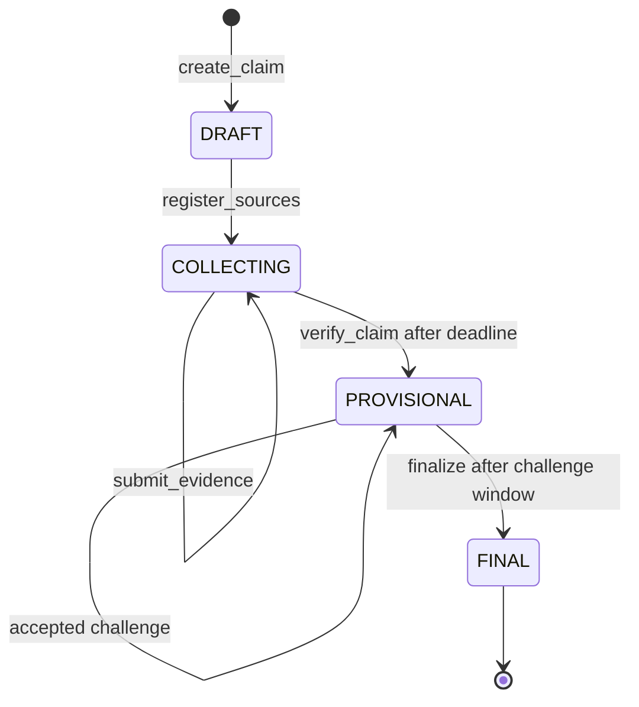

# SourceQuorum

A reusable GenLayer Intelligent Contract for resolving a precisely defined public event from three precommitted source origins. It detects contradictory evidence, collapses dependent reporting, and returns `VERIFIED`, `REFUTED`, `CONTESTED`, or `INSUFFICIENT`.

This repository contains the standalone contract, ABI, SDK-based tests, a reproducible offline demo, archive preparation tool, CI, and Studio deployment instructions. There is no frontend or external-wallet requirement.

## Quick start

Requires Python 3.12+.

```bash
pip install -r requirements-dev.txt
genvm-lint check contracts/source_quorum.py
genvm-lint typecheck contracts/source_quorum.py
pytest -q
python scripts/demo.py --check
```

`demo.py` runs the actual contract against GenLayer's in-memory SDK with explicitly mocked archive responses and model classifications. It exercises all four verdicts, invokes the captured validator independently, and finalizes every example. It is not evidence of a live multi-validator network run. Expected results: [examples/demo-output.json](examples/demo-output.json).

## How resolution works

1. A creator locks the claim, event criteria, historical cutoff, submission deadline, minimum independent publishers (2 or 3), and challenge duration (60 seconds–7 days).
2. Before collecting evidence, that creator registers exactly three HTTPS source origins, publisher groups, and ownership notes. The registry is then immutable.
3. The creator commits up to one initial archived item per source. Every item pins an original URL, a timestamped Wayback `id_` URL, and a SHA-256 of the complete response body.
4. After the submission deadline, anyone can request verification. Each participating validator independently retrieves the archived bodies, checks hashes/capture headers, and classifies the content against the locked event definition.
5. Deterministic aggregation collapses shared publishers, byte-identical articles, and semantically dependent reporting into source groups. One group counts at most once on each side.
6. A fixed challenge window starts. Anyone can submit additional allowlisted historical evidence. Accepted challenges add material evidence and preserve previously accepted classifications; they never extend the deadline.
7. Anyone can finalize once the challenge window ends. Final state cannot be reopened.



## Verdict rules

| Evidence after eligibility and independence checks | Verdict |
| --- | --- |
| At least one supporting and one refuting group, even within the same publisher | `CONTESTED` |
| Supporting groups reach the minimum, no eligible refutation | `VERIFIED` |
| Refuting groups reach the minimum, no eligible support | `REFUTED` |
| Everything else, including no available evidence | `INSUFFICIENT` |

Missing evidence never means false. A prediction of a delay before the deadline does not prove the event missed the deadline. Testnet announcements do not establish production-mainnet launches.

## API

All timestamps in method arguments are Unix seconds in UTC. `source_index` is 0, 1, or 2. View methods return canonical JSON strings so another contract or SDK client can parse a stable schema.

| Method | Arguments | Access |
| --- | --- | --- |
| `create_claim` | `claim_id, text, criteria, cutoff, submission_deadline, minimum, challenge_seconds` | Anyone; unique ID |
| `register_sources` | `claim_id, sources_json` | Creator; once before deadline |
| `submit_evidence` | `claim_id, source_index, original_url, archive_url, sha256` | Creator; before deadline |
| `verify_claim` | `claim_id` | Anyone; once after deadline |
| `challenge_verdict` | Same arguments as `submit_evidence` | Anyone; within fixed window |
| `finalize_claim` | `claim_id` | Anyone; after fixed window |
| `get_claim` | `claim_id` | Public; full audit record |
| `get_verdict` | `claim_id` | Public; verdict, final flag, policy/source hashes, challenge deadline |

Source registry example:

```json
[
  {"origin":"https://project.example.org","publisher":"project","ownership_note":"Project's official publication"},
  {"origin":"https://news.example.org","publisher":"newsroom","ownership_note":"Separately owned newsroom; assess original reporting"},
  {"origin":"https://research.example.org","publisher":"research","ownership_note":"Independent research organization"}
]
```

Example domains and XYZ events are fictional. Replace them with reviewed publishers and authentic pre-cutoff archives for a real claim. Source origins contain no path, port, credentials, or trailing slash. Original evidence URLs must start with that exact origin plus `/`.

Prepare a genuine existing snapshot:

```bash
python scripts/prepare_evidence.py CLAIM_ID 0 ORIGINAL_HTTPS_URL EXACT_WAYBACK_ID_URL
```

The tool prints ready-to-use argument values only after validating its response. It does not fabricate publication dates, create missing archives, or silently accept a different capture. Contract validators repeat retrieval independently.

## Consensus and auditability

`gl.vm.run_nondet_unsafe` uses an independent leader/validator pair. The validator re-runs the complete archive retrieval and semantic extraction, then compares **all stable decision fields**: per-item stance, publication time, exclusion reason, dependence edges, canonical source groups, corroboration counts, and derived verdict. JSON shape validation alone is never sufficient.

Policy/source hashes use canonical ASCII JSON and SHA-256; evidence hashes cover exact full response bytes. Accepted history entries retain assessment rows, timestamps, evidence counts, and an evidence-set hash. The creator cannot rewrite any of these through the public interface. Transaction time is GenVM's deterministic `datetime.now(timezone.utc)`.

Consumers must require `final == true`, check both expected policy/source hashes, and check network transaction finality separately. `FINAL` is the application phase; it does not assert protocol finality. Both `CONTESTED` and `INSUFFICIENT` need a consumer-defined fallback. Never settle from the verdict label alone.

## Scope and trust assumptions

- This is an MVP oracle under a curated source policy, not a proof of objective truth. A creator can choose biased sources or dishonest publisher metadata. Consumers must approve the policy and registry hashes. Semantic dependence checks supplement this curation; they cannot prove corporate ownership or eliminate collusion.
- Wayback is a shared archival trust/availability dependency. Multiple publishers do not make the archive infrastructure decentralized. SHA-256 proves body identity, not truthful authorship or event occurrence.
- Only exact timestamped HTTPS Wayback snapshots are supported. The `Memento-Datetime` must equal the requested capture and be at/before the cutoff and submission time. Redirects to another capture, non-200 responses, missing headers, mismatched bytes, unsupported MIME, non-UTF-8 bodies, and bodies over 80,000 bytes are excluded. Large/poorly archived modern sites may therefore yield `INSUFFICIENT`.
- Publication dates are semantically extracted. Date-only evidence is conservatively assigned the end of that UTC day; undated or post-capture evidence is excluded. Strict date/stance agreement can fail network consensus. An undetermined network transaction leaves prior state unchanged; it is different from an accepted `INSUFFICIENT` verdict.
- Each source has at most two accepted evidence slots in total (initial plus challenge, or two challenges if initially empty). No deposits, incentives, slashing, automated transactions, payouts, appeals beyond the fixed window, or automatic finalization are included. Finalization requires a transaction.
- Challenges append valid material evidence rather than replacing historical evidence. Contradictions conservatively remain contested. Re-evaluation cannot discard previously accepted evidence because an archive later becomes unavailable. Unavailable initial evidence cannot always be remedied by a challenge; a new claim can use a revised policy.
- No audit has been performed. See [design and threat model](docs/DESIGN.md), [Studio guide](docs/STUDIO.md), and [deployment record](deployments/studio.json).

## References

- [GenLayer Equivalence Principle](https://docs.genlayer.com/developers/intelligent-contracts/equivalence-principle)
- [Web access](https://docs.genlayer.com/developers/intelligent-contracts/features/web-access)
- [Transaction context](https://docs.genlayer.com/developers/intelligent-contracts/features/transaction-context)
- [Testing Intelligent Contracts](https://docs.genlayer.com/developers/intelligent-contracts/testing)

MIT licensed.
