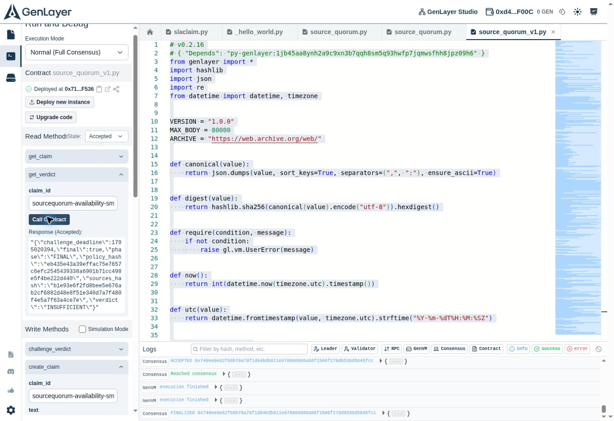

# Validation record — November 18, 2026

## Local SDK validation

| Check | Observed result |
| --- | --- |
| `genvm-lint check contracts/source_quorum.py` | Lint and exact-SDK validation passed; 6 write, 2 view methods |
| `genvm-lint typecheck contracts/source_quorum.py` | No type errors |
| `pytest -q` | 33 passed |
| Nondeterministic closure pickling checks | Enabled in SDK test fixture and offline demo |
| `python scripts/demo.py --check` | Four scenarios matched committed output, finalized, captured validator agreed |
| `python scripts/prepare_evidence.py --help` | CLI starts and displays expected arguments |
| Python compile checks | Scripts and tests compile |

Tests and the demo explicitly select SDK release `v0.2.16` rather than relying on a local cache or latest release discovery. Tests use the pinned GenVM SDK, real persistent storage emulation, and controlled web/model responses. Cases include all four verdicts, zero evidence, undated/post-capture evidence, byte and semantic source dependence, transitive dependence, hash/MIME/status/size/capture failures, malformed model output, validator dissent, creator permissions, policy locking, archive/origin validation, material challenges, preservation of prior accepted evidence, exact deadline boundaries, and immutable final state.

These tests establish behavior under specified mocked inputs. They do not measure model fact-checking accuracy or prove that a set of real archives is reachable from all validators.

## Hosted Studio lifecycle

- Environment: GenLayer hosted Studio simulator, Normal (Full Consensus).
- Account: Studio built-in account; no external wallet connection.
- Contract: `0x71B6C44Ab78C8CE18f9CEfdd20C0a94a2cb9F536`.
- Uploaded release source was checked in the UI: 17,702 characters, using the final structured JSON response API.
- Claim: `sourcequorum-availability-smoke`.
- Sources: three explicitly fictional test origins, locked as a policy. No evidence submitted and no actual event asserted.
- Deployment, claim creation, source registration, verification, and finalization transactions each displayed `FINALIZED` in the Studio UI.
- `get_verdict` returned `phase: FINAL`, `final: true`, `verdict: INSUFFICIENT`, and the locked commitment hashes.
- Complete observed transaction hashes and source SHA-256 are in [deployments/studio.json](../deployments/studio.json).

This validates deployment and the no-evidence lifecycle. Because the claim has no evidence, it does not exercise live archive fetching or live LLM semantic extraction. Those paths are exercised with mocks in the SDK tests. No public testnet deployment is claimed.

